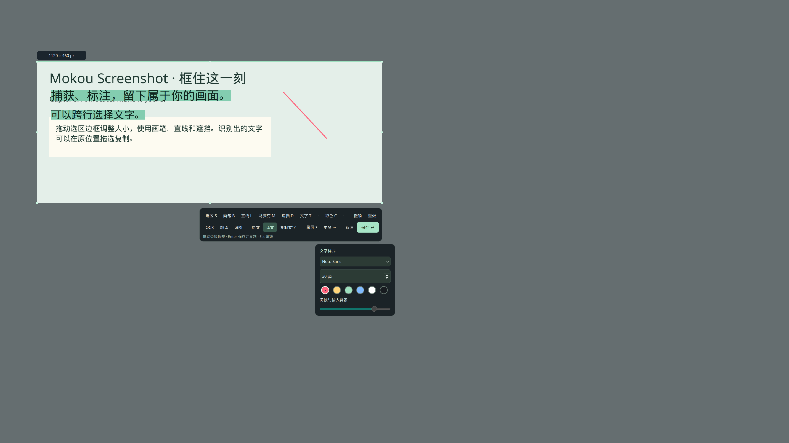

# Mokou Screenshot

用于 **Fedora KDE Plasma Wayland** 的截图、标注与区域录屏工具。按 **PrtScn** 冻结桌面，框选后继续调整；保存时写入 PNG 并复制图片到剪切板。

当前版本 **0.4.2** · [MIT](LICENSE) · [版本记录](docs/CHANGELOG.md)



## 功能

- 框选后调整大小、移动选区；画笔、直线、涂抹式马赛克、遮挡、文字和像素取色。
- 本地 RapidOCR：中英日混合、法语、韩语、俄语；也可切换视觉 AI。
- OCR／译文原位显示、跨框选择复制；长译文就地展开，识图结果直接显示在工具栏旁。
- 横向／纵向拼长图；区域录屏支持 MP4、WebM，系统声音与麦克风按需开启。
- OpenAI 兼容 API，可连接本地模型；翻译复用 OCR 原文，只发送文字。

## 安装

目标环境为 KDE Plasma Wayland。需要 Qt ≥ 6.8、KPipeWire ≥ 6.7，以及以下 Fedora 构建依赖：

```bash
sudo dnf install gcc-c++ cmake ninja-build extra-cmake-modules \
  qt6-qtbase-devel qt6-qtwayland-devel kf6-kglobalaccel-devel \
  kpipewire-devel layer-shell-qt-devel plasma-wayland-protocols-devel
```

下载或克隆源码，在工程根目录运行：

```bash
# 本地 OCR 还需要 uv；安装脚本会准备独立的 Python 3.12 和模型
sudo dnf install uv
./scripts/install.sh
~/.local/bin/mokou-screenshot --background
```

仅使用 API OCR 时可运行 `./scripts/install.sh --without-ocr`，随后在设置→OCR 选择视觉 AI。录屏需要 FFmpeg；录音需要其 PulseAudio 输入、Opus／AAC 编码能力和 pactl。详见 [开发与依赖](docs/DEVELOPMENT.md)。

默认安装到 `~/.local`，并启用登录待命。真实屏幕捕获需要安装后的应用权限声明。PrtScn 若被占用，请在 KDE 系统设置→快捷键中调整。

## 使用

| 操作 | 用法 |
| --- | --- |
| 框选／调整 | 拖动框选；拖边框缩放，拖内部移动；方向键微调，Shift 加速 |
| 保存 | Enter 或“保存”：保存截图和标注、复制图片、关闭编辑界面 |
| 工具 | S 选区、B 画笔、L 直线、M 马赛克涂抹、D 遮挡、T 文字、C 取色 |
| 样式 | 工具旁小菜单直接调整；马赛克直径独立，文字样式与取色倍率自动记住 |
| 文字输入 | Enter 提交文字，下次 Enter 保存截图 |
| 文字阅读 | 选择原文／译文；跨框拖选后 Ctrl+C；“复制文字”优先复制选中内容 |
| 撤销／重做 | Ctrl+Z／Ctrl+Shift+Z |
| 录屏 | 菜单内选择声音；再次按 PrtScn 停止并保存，默认静音 MP4 |
| Esc | 先关闭当前菜单或文字选择，再取消活动识别／截图 |

截图默认保存在 `~/图片/屏幕截图`，录屏在 `~/视频/屏幕录制`，可在设置中更改。托盘进程持有剪切板；退出会先完成活动录屏的文件封装。

## OCR 与 AI

RapidOCR 在本地识别，模型只在安装时下载。AI 的地址、模型、翻译语言和提示词在设置中填写；Key 只保留在会话内存，也可通过 `MOKOU_API_KEY` 传入。

模型请求由点击触发：视觉 OCR／识图只发送当前选区的合成图，翻译只发送 OCR 原文。识别结果、译文和输入背景不进入导出的 PNG。图片不会为识别而写入临时文件。

[API 接口与提示词](docs/API.md) · [本地 OCR 模型](docs/OCR.md) · [交互说明](docs/INTERACTION.md)

## 更新与卸载

更新前从托盘退出，再运行安装脚本。卸载使用 `./scripts/uninstall.sh`；它保留截图、录屏、设置和 OCR 环境，并打印环境位置。

## 开发与许可

从 [文档索引](docs/README.md) 进入。提交改动请参考 [贡献说明](CONTRIBUTING.md)；发布流程见 [发布说明](docs/RELEASING.md)。

自有代码采用 MIT；依赖与生成协议绑定的许可见 [第三方声明](THIRD_PARTY_NOTICES.md)。
